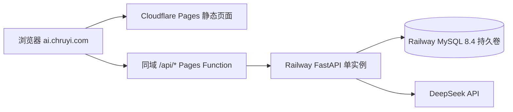

# Cloudflare Pages + Railway 部署手册

本文对应第一版公开 Demo：Cloudflare Pages 托管 React 页面和同源 API 代理，Railway
运行单实例 FastAPI 与 MySQL 8.4。它不是“点一下自动上线”；先按本文准备变量，再逐项验收。

## 1. 上线结构



浏览器仍请求 `/api/v1/...`。本地由 Vite 代理；生产环境由
`frontend/functions/api/[[path]].js` 转发。因此 Cookie 对浏览器仍属于
`ai.chruyi.com`，不需要把登录改成跨站 Cookie，SSE 也能继续逐块传输。

Pages Function 会删除浏览器伪造的代理头，加入共享密钥和 Cloudflare 已确认的客户端 IP。
FastAPI 生产环境启用 `HTTP_REQUIRE_TRUSTED_PROXY=true` 后，会拒绝绕过 Pages 直连 Railway
业务接口。`/health` 和 `/ready` 仍可供平台检查，但不返回秘密或用户数据。

## 2. 上线前必须准备的值

先生成一个至少 32 字符的随机代理密钥。下面的命令只在终端打印一次结果，不写文件：

```bash
openssl rand -hex 32
```

同一个值分别保存到：

- Cloudflare Pages Secret：`PROXY_SHARED_SECRET`
- Railway FastAPI Secret：`HTTP_PROXY_SHARED_SECRET`

不要把这个值发到聊天、截图、源码或 GitHub。还需要在 Cloudflare Turnstile 创建一个 Widget，
允许主机名 `ai.chruyi.com`，记录公开的 Site Key 和私密的 Secret Key。

## 3. Railway MySQL

1. 在与后端相同的 Railway Project、Environment 和 Region 创建 MySQL 服务。
2. 固定 MySQL 8.4；不能使用 MariaDB 或 MySQL 8.0。
3. 确认 `/var/lib/mysql` 使用持久卷，并开启平台备份。
4. 新库保持为空；迁移程序负责创建表，不能在控制台手工创建同名表。
5. 初始化后执行 `SELECT VERSION()`，确认真实版本。

“持久卷”是数据库容器之外保存 MySQL 数据文件的独立存储。重新部署或替换容器后，
新容器仍挂载同一份数据；删除卷依然会丢数据，所以持久卷不等于备份。

## 4. Railway FastAPI 服务

连接 GitHub 仓库的 `main` 分支，设置：

| 设置 | 值 |
|---|---|
| Root directory | `/backend` |
| Builder | Railpack |
| Build command | `uv sync --locked --no-dev` |
| Pre-deploy command | `uv run --no-sync python -m app.db.migrate` |
| Start command | `uv run --no-sync uvicorn app.main:app --host 0.0.0.0 --port "$PORT" --workers 1` |
| Healthcheck path | `/ready` |
| Replicas | `1` |
| Serverless / sleep | 关闭 |
| Automatic deploys | 第一版关闭 |

环境变量：

```text
RAILPACK_PYTHON_VERSION=3.14

DB_HOST=${{MySQL.MYSQLHOST}}
DB_PORT=${{MySQL.MYSQLPORT}}
DB_NAME=${{MySQL.MYSQLDATABASE}}
DB_USER=${{MySQL.MYSQLUSER}}
DB_PASSWORD=${{MySQL.MYSQLPASSWORD}}

MODEL_PROVIDER=deepseek
MODEL_NAME=deepseek-v4-pro
MODEL_BASE_URL=https://api.deepseek.com
MODEL_API_KEY=<Railway Secret>

HTTP_ALLOWED_ORIGINS=["https://ai.chruyi.com"]
HTTP_COOKIE_SECURE=true
HTTP_REQUIRE_TRUSTED_PROXY=true
HTTP_PROXY_SHARED_SECRET=<与 Pages 相同的随机 Secret>

TURNSTILE_ENABLED=true
TURNSTILE_SECRET_KEY=<Turnstile Secret Key>
TURNSTILE_EXPECTED_HOSTNAME=ai.chruyi.com
TURNSTILE_EXPECTED_ACTION=register

GENERATION_USER_DAILY_LIMIT=30
GENERATION_GLOBAL_DAILY_LIMIT=500
GENERATION_GLOBAL_CONCURRENCY_LIMIT=2

LANGSMITH_TRACING=false
```

MySQL 模板若只提供 root，初次演示可以先验证部署，但正式公开应另建仅能访问本项目库的应用
账号。迁移账号可以再与普通运行账号拆分；当前代码先统一读取 `DB_*`。

### 为什么只能一个实例

后端启动时同时取得本机文件锁和 MySQL advisory lock。MySQL 锁依附于一条专用数据库连接：
连接存在时，第二个后端无法启动；进程退出或连接断开时，MySQL 自动释放。这样新部署不会在
旧部署仍生成回答时执行启动清理。

`/ready` 会检查 `SELECT 1` 和这把数据库锁；任何一项失败就返回 503。它不是模型余额检查。

## 5. Cloudflare Pages

连接同一仓库的 `main` 分支，设置：

| 设置 | 值 |
|---|---|
| Root directory | `frontend` |
| Build command | `npm run build` |
| Build output directory | `dist` |
| Node version | `22.16.0` 或满足 package.json 的固定版本 |

变量：

```text
VITE_TURNSTILE_SITE_KEY=<Turnstile 公开 Site Key>
BACKEND_ORIGIN=https://<Railway 后端域名>.up.railway.app
PROXY_SHARED_SECRET=<与 Railway 相同的随机 Secret>
```

其中 `PROXY_SHARED_SECRET` 必须设为 Secret；`VITE_TURNSTILE_SITE_KEY` 会进入浏览器构建，
本来就是公开值。`BACKEND_ORIGIN` 只能是固定 HTTPS Origin，不能包含路径、账号、查询参数。

在 Pages 添加自定义域名 `ai.chruyi.com`，按 Cloudflare 提示确认 DNS 和 HTTPS。预览域名不在
Turnstile 与后端允许列表中，因此预览部署不能直接注册；第一版用独立测试后端时再单独开放。

## 6. 首次部署顺序

1. 在 `dev` 跑完后端测试、真实 MySQL 迁移测试和前端生产构建。
2. 合并到 `main`；不要提交任何 `.env`、密码或 API Key。
3. 创建空 Railway MySQL，确认 8.4、持久卷和备份。
4. 部署 FastAPI；pre-deploy 先迁移，启动后确认 `/health` 为 200、`/ready` 为 200。
5. 部署 Pages，绑定 `ai.chruyi.com`。
6. 验收注册、登录、刷新登录、退出和 Turnstile。
7. 用两个账号确认不能读取对方的会话与 Profile Memory。
8. 验收 SSE：思考/回答逐步出现，断线与失败提示正常。
9. 保存一条聊天和记忆，重启后端后确认数据仍存在。
10. 做一次数据库备份与恢复演练。

## 7. 第一版更新流程

自动部署保持关闭。更新时：

1. 页面进入维护状态，停止接受新聊天。
2. 停止旧 FastAPI，确认旧部署已退出。
3. 运行 pre-deploy 迁移。
4. 启动一个新 FastAPI worker，等待 `/ready` 成功。
5. 恢复页面访问并做登录、聊天、记忆冒烟测试。

迁移命令和后端使用同一把 MySQL 锁；如果旧后端还活着，迁移会失败，而不是冒险修改正在使用
的数据库。不要通过 `alembic stamp` 或删除锁来绕过失败，先检查真实部署与数据库状态。

## 8. 成本与滥用保护

- 注册必须经过 Turnstile 服务端验证，token 只能使用一次且会过期。
- 每用户每日 30 次、全站每日 500 次、全站最多 2 个正在生成；计数存于 MySQL，重启不清零。
- 每次真正接受的新发送或失败重试计一次；网络用同一 `client_message_key` 重发不重复计数。
- 一次聊天内部可能执行“记忆判断 + 正式回答”两次模型调用，所以聊天次数不等于供应商请求数。
- 仍应在 DeepSeek 控制台设置余额告警/预算，并定期查看 Railway 与 Cloudflare 日志。

这些措施适合课程 Demo，不等于完整的商业生产安全方案。

## 官方资料

- [Cloudflare Pages Functions 文件路由](https://developers.cloudflare.com/pages/functions/routing/)
- [Cloudflare Turnstile 服务端验证](https://developers.cloudflare.com/turnstile/get-started/server-side-validation/)
- [Railway Pre-deploy Command](https://docs.railway.com/deployments/pre-deploy-command)
- [Railway Healthchecks](https://docs.railway.com/deployments/healthchecks)
- [Railway 部署生命周期与新旧版本重叠](https://docs.railway.com/deployments/reference)
