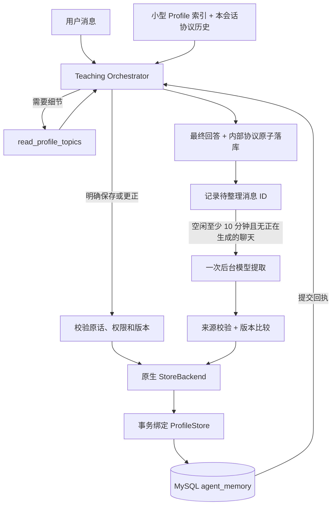

# 记忆生命周期：即时工具 + 空闲整理

2026-10-12 起的实现。本文替代旧文档中“每轮先运行独立 Memory Agent”的流程描述；历史设计保留用于追溯。

## 现在谁负责回答、谁负责记忆

正式聊天只有一个 Teaching Orchestrator（Deep Agents 图）。它保持 DeepSeek thinking 模式，自己回答，也可以调用后端绑定的两种工具：

- `read_profile_topics`：按主题读取本人的完整 Profile 快照。
- `save_profile_facts`：处理用户明确要求记住、保存或更正的长期事实；数据库提交确认后才返回成功。

普通问答通常一次模型调用；读记忆、保存、再回答属于同一图的工具循环，不是保证只请求模型一次。每轮最多四次模型请求、两次读取、一次写入批次；第四次只能回答。保持原有整轮 120 秒总期限、每次输出 4096 tokens 和不自动重试模型请求的限制。新预算是“聊天轮次”配额，不能把一次轮次当成一次供应商收费请求。



这借鉴了“任务内即时更新、任务间整理、按需读取”的记忆生命周期，并不意味着采用了 ChatGPT 的内部实现。存储仍是项目自己的 MySQL，不是 OpenAI 服务。文件接口现已采用原生 Deep Agents `StoreBackend`，主图配置 `store=store`；`checkpointer=None`，重启不会恢复执行到一半的 Agent 图。

## StoreBackend 与持久化存储（2026-10-24 更新）

- `factory.py` 直接实例化框架的 `StoreBackend`；已移除自写的 `ProfileMemoryBackend`。读取、分页、目录和文件搜索由框架实现。共享 `RunScopedStore` 没有用户状态，只把操作转交给当前运行上下文的 Store。
- `app/agent/profile_store.py` 的 `ProfileStore` 实现 LangGraph `BaseStore`，把已有 MySQL `agent_memory` 表映射成文件数据。它是项目自己的数据库适配层，不是假设框架自带 MySQL 驱动。
- 每用户 namespace 为 `("users", str(verified_user_id), "profile")`。用户 ID 来自认证后的业务上下文，不能由模型参数指定。
- `/memories/topics/<topic>.md` 对应一条已有主题记录；`/memories/profile.md` 是这些记录派生的展示内容，正式模型看到的仍是每轮最多 4 KiB 的简短索引。索引不另外落库、不成为第二份权威数据。
- Store 有两种明确生命周期：**事务绑定实例**使用调用方的 SQLAlchemy Session 访问 MySQL；**本轮快照实例**只提供固定的只读内容给图。快照内部的 `InMemoryStore` 是临时读取视图，不是长期记忆数据库；数据库读取时也复用其最多 26 个文件的过滤/分页逻辑。
- 即时保存和空闲整理都经过 `StoreBackend → 事务绑定 ProfileStore → agent_memory`。Store 不自行提交事务；事实审核、版本检查、记忆写入、任务结算仍由业务层控制，相关数据一起提交或回滚。
- 图上的 Store 不允许写入；Agent 仍调用 `save_profile_facts`，不开放 `write_file/edit_file` 绕过审核。教学 Skill 也在只读快照中，不能被记忆工具覆盖。

这次不新增依赖、数据库表或环境变量，不需要搬迁旧记忆。它不是通用沙箱存储：任意文件写入、删除、TTL 和向量搜索仍未启用。未来要存用户上传资料/沙箱产物，应增加独立 namespace 和相应存储实现，不能塞进受限的 Profile 主题表。

## 图的生命周期：复用结构，不复用用户状态

`build_chat_agent(settings, policy)` 现在只接收固定配置，返回可复用的编译图。
FastAPI 的 `BackendRuntime.chat_agents` 按已校验归属的 `(user_id, session_id)` 缓存图。
同一会话第一轮真正执行时创建自己的图，后续消息与重试复用它；不同会话使用不同图，
即使属于同一个用户也不共享。CLI 在自己的循环中也持有一个 `ChatAgentProvider`，切换新会话会创建另一张图。
缓存随进程存活，重启后按需重建；数据库中的历史和长期记忆不受影响。
配置不同的应用实例不共享图；配置运行中改变时要求重启，不缓存多份密钥或静默套用旧策略。

每次执行通过 `prepare_run_context(prepared, turn)` 创建独立 `ChatRunContext`，再传入
`agent.astream(..., context=context)`。该上下文包含当前用户的记忆快照、有效生成权限和本轮 `TurnMemory`。
会话图内跨轮复用的中间件没有 `self.turn`，工具也不绑定 `turn.read/turn.save`；它们通过 LangGraph runtime 找到本次调用的 turn。
StoreBackend 的 namespace 和 Store 操作同样从 runtime 获取，因此不会用到上一轮过期的记忆快照。

同一个 context 只能运行一次；下一轮或重试必须创建新 context。计数、读取记录、协议、输出及取消作用域各自独立。
`checkpointer=None` 保持不变：图复用不会自动记住上次运行的 state，历史照旧从 MySQL 按会话重建。
正式聊天使用异步图执行；无工具离线探针可使用 `with_memory_tools=False`。
独立调用 `execute_chat_turn/execute_chat_retry` 时应传同一个 `agent_provider` 才能复用；省略只用于一次性运行。

## 渐进读取与工具协议

每轮初始只向模型提供最多 4 KiB 的确定性索引：主题、前 32 个字符预览、是否截断。它不是第二份可编辑记忆。模型需要完整内容时调用读取工具；更新已有主题前，工具强制要求先读完整主题。每个主题仍是最多 500 字符的完整摘要，保存时应保留未被更正的旧事实。

`/memories/profile.md` 仍是只读虚拟文件，这次装的是索引，不是宿主机磁盘路径。没有开放 shell、任意文件、子 Agent 委派或模型指定 user_id 的能力。输入检查会计算框架提示、实际工具 schema、历史推理和工具结果；超限不会静默截断当前问题，历史只能整轮移除。

DeepSeek thinking + tools 需要回传模型实际返回的 `reasoning_content` 和配对工具消息。`ProtocolChatDeepSeek` 补齐当前上游适配器序列化时遗漏的字段：不伪造推理，不为缺字段的旧回答填空串。旧历史转为明确标记的不可信引用上下文；新历史使用内部保存的完整协议。

模型正文在工具调用前可能先输出“我先查看一下”。SSE 新增 `model_step`（`start` / `tool` / `final`）；网页把工具前导文字移到“处理步骤”，只把最终答案写入公开聊天正文。终端用步骤标签区分。工具参数不会作为回答正文直接输出。

## 两种保存时机

即时保存：例如“请记住我喜欢中文解释”“请更新记忆：以后用英文”。后端要求明确保存意图、允许的主题、当前或最近一条用户消息中的原话、敏感规则和有效生成编号；已有主题还要检查读取记录和版本。引用必须真的出现，但引用校验不等于完整语义证明。保存失败或提交结果不明确时，不返回成功；已提交记忆不会因随后回答失败而回滚。

空闲整理：成功聊天的用户消息 ID 在回答提交时进入持久队列。只有用户至少 10 分钟没有活动、没有正在生成的消息，并且全站没有前台生成或其他整理任务时才领取。后台只读本次待处理的成功用户消息及已有 Profile，不用助手回答推断用户事实。不同会话带 `session_id`，提示禁止跨会话解析代词。只整理明确、长期、第一人称事实，不推断能力、性格或“问过某题所以有某种兴趣”。

一次任务最多 32 条消息，原文序列化上限 24 KB，并随已有 Profile 大小缩小批次；调用前再检查完整输入预算。单条原文装不下时不会截断后跳过，而是保留队列、暂停该用户整理，记录 `MEMORY_SOURCE_TOO_LARGE`。需要人工检查数据和策略，不应靠不断重试解决。

后台任务每次最多一次非 thinking 模型请求，默认 25 秒；每用户每日 5 次、全站每日 50 次（UTC）。领取即占额度，失败也计数；因此费用不会因失败重试无限增长。第一次失败后等 1 分钟、第二次后等 5 分钟，第三次失败暂停；有新的成功聊天会重新激活。达到日额度则等下一 UTC 日。后台正在调用时也占用前台使用的全站并发容量，但已领取的任务不会因新请求而被强制抢占。

## 数据在哪、如何防止覆盖

| 表 | 内容 |
|---|---|
| `agent_memory` | 唯一权威 Profile，公开记忆抽屉读取此表 |
| `agent_turn_records` | 本轮实际模型推理、工具请求/结果、最终 AI 消息；完整协议用于内部回放，仅推理文本可由所属用户按需查看 |
| `memory_consolidation_state` | 用户待处理 ID、活动时间、重试时间、失败数和暂停状态 |
| `memory_consolidation_jobs` | 已领取任务、来源 ID、状态、UTC 额度日期和安全错误码 |
| `memory_topic_revisions` | 主题版本及最新来源消息 ID |

任务领取和生成准入由已有 `generation_control` 行锁协调；模型调用期间不持有数据库事务。即时写入与后台提交都比较读取时的主题版本，并禁止更老的来源消息覆盖新来源。冲突后保留待处理数据；重新领取时读最新 Profile。已有更新明确覆盖旧证据时，旧候选被丢弃而不是再覆盖新值。

待处理集合记录实际消息 ID，不只靠最大 ID 推进，因此早先失败、后来重试成功的旧编号不会丢失。候选、主题版本、任务成功和待处理集合移除在一个事务内提交。重启在取得全库运行锁后，把遗留 RUNNING 整理任务记为中断并按重试策略处理；取消会等待正在提交的短事务结束，再释放运行锁。

迁移不会把原有聊天全量加入整理队列。部署新代码后成功的消息会排队，即使后台开关暂时关闭；之后启用会处理这些待办，而不是回填迁移前的旧聊天。

## 隐私变化与局限

持久保存 API 返回的推理及工具协议。完整协议仍不出现在历史或记忆 API 中；新增 `GET /api/v1/chat/sessions/{session_id}/messages/{message_id}/reasoning`，仅允许登录用户读取自己成功回答对应的推理文本，返回 `{message_id, available, steps: [{step, text}]}`。不会返回工具参数、工具结果或后台整理记录。旧回答没有记录或推理为空时返回 `available: false`；损坏记录或数据库故障返回安全的 503，不补造历史推理。

网页在每条历史回答上方默认收起“查看模型思考”，首次展开才请求，按模型步骤以纯文本展示。响应禁止缓存，前端仅在当前组件内暂存，切换会话或退出账号清理；原有实时推理流保留。刷新后可再次读取，不需要新迁移或额外模型调用。

这是将原本内部保存的推理文本开放给记录所属用户：推理文本可能复述输入、提示或工具信息，字段白名单不等于内容脱敏，也不保证推理正确。未来接入隐藏测试和私有诊断前，必须重新审查实时与历史推理展示边界。数据仍需同聊天一样的访问控制和备份保护。尚未增加自动 TTL、用户删除或更正管理页面；删除用户/会话时必须一并处理新表外键，不能只删 `messages`。

开启 LangSmith 会把对话、提示、记忆及工具轨迹上传到 tracing 服务；后台整理沿用这个配置。敏感关键词/号码过滤是保守防线，不是完整隐私分类器，会误拒也可能漏检。后台自动合并仍可能理解错误，所以默认关闭，需要真实模型验收后再启用。新增协议和待办表会增加数据库容量，应监控积压和备份大小。

## 迁移与分阶段启用

新 Alembic head：`20261012_0003`，新增四张表。不要在本地终端连接生产库直接试命令。按现有维护流程，备份并停止旧后端（包括连接同库的终端/副本），确认退出后在目标后端环境执行：

```bash
uv run --no-sync python -m app.db.migrate
```

然后启动新后端，保持一个副本、一个 Uvicorn worker。Railway 更新有旧进程重叠时，迁移拒绝获取锁是安全保护，不要删锁或跳过迁移。

第一阶段保持：

```dotenv
MEMORY_BACKGROUND_ENABLED=false
```

先验收普通问答、明确保存、已有主题更新、跨会话读取、失败重试和流式前导文字。即时工具循环没有独立开关，属于此次主路径更新。第二阶段确认真实模型兼容性、质量和费用后再启用：

```dotenv
MEMORY_BACKGROUND_ENABLED=true
MEMORY_IDLE_SECONDS=600
MEMORY_POLL_SECONDS=15
MEMORY_USER_DAILY_LIMIT=5
MEMORY_GLOBAL_DAILY_LIMIT=50
MEMORY_TIMEOUT_SECONDS=25
```

Worker 由 FastAPI lifespan 管理，无需额外服务、Redis 或新密钥。CLI 使用相同即时工具和协议保存，但不会启动后台 worker；需要启动 FastAPI 才执行空闲整理。关闭后台开关只停止新的整理，不撤销已经保存的事实或删除队列。完整回退旧代码需另行评估迁移 head；不要直接 downgrade 丢弃内部记录。

## 验证与代码入口

- `app/agent/orchestrator.py`：主图工具、索引、历史协议与调用限制。
- `app/agent/consolidation.py`：单次提取和可取消 worker。
- `app/services/memory_tasks.py`：领取、重试、配额、版本冲突与原子提交。
- `app/services/generation_result.py`：最终回答、协议和待办一起提交。
- `tests/test_memory_orchestrator.py`：真实 Deep Agents 图 + 本地假模型，禁止网络。
- `tests/test_memory_mysql.py`：显式指定隔离测试容器，验证迁移、恢复、冲突及真实执行链路；默认离线测试跳过。

在 `backend/` 运行离线测试：`uv run python -m unittest discover -s tests`。原有完整数据库验收入口仍是 `uv run python scripts/check_migration_mysql.py`，它自己新建并销毁临时容器，不使用项目库。前端 `npm run build` 包含测试、类型检查和构建。

本轮假模型验证不等同于已验证真实 DeepSeek thinking/tool 协议、模型提取质量或公网 SSE 链路；正式启用前还需要人工验收，会消耗模型余额。

本轮验证：472 项离线测试、13 项新增隔离 MySQL 记忆测试、原有 154 项 MySQL 端到端测试通过；真实 MySQL 上迁移升级、重跑、降级、再次升级及 Alembic schema 检查通过。前端 6 项测试、TypeScript 检查、生产构建通过；后端 Ruff 与 Basedpyright 检查通过。只使用临时 MySQL 和模型替身，没有迁移现有开发/生产库，也没有执行发布。
